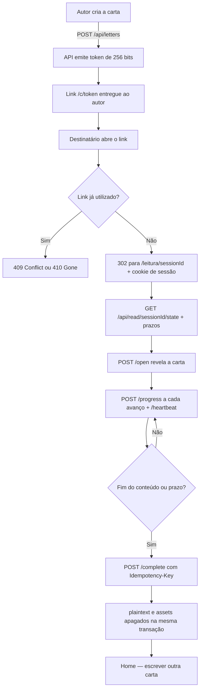

# Entrelinhas

**Cartas digitais que se despedem.** O Entrelinhas é uma aplicação web para escrever cartas que podem ser lidas uma única vez: depois de aberta, a mensagem se apaga progressivamente conforme o leitor avança.

## Objetivo

Recriar, no ambiente digital, a sensibilidade de uma carta manuscrita que se consome ao ser lida. A proposta é valorizar a escrita direta, o gesto de enviar e a natureza efêmera da mensagem — sem contas de usuário, feeds ou histórico persistente da leitura.

O projeto é um monorepo de estudo e demonstração, organizado para evolução incremental com testes automatizados em cada etapa. O contrato de comportamento da API está documentado em [`docs/api.md`](docs/api.md).

## Funcionalidades principais

- **Criação de cartas:** remetente (com opção de anonimato), destinatário, título, mensagem e assinatura.
- **Personalização:** combinação livre de envelope, selo, paleta de cores, tipografia e textura do papel — inclui **selo em branco**, desenhado em canvas com pincel, cores e borracha.
- **Fotos:** até 3 imagens (2 MiB cada) enviadas pelo seletor de arquivo ou por arrastar e soltar; aparecem no meio do texto da prévia e da carta.
- **Opções de leitura no painel:** escolha se as palavras somem gradualmente (`fadeEnabled`) e o prazo da carta (`readTimeLimitSeconds`, 60 s a 60 min).
- **Prévia em tempo real:** a carta é mostrada como será lida, antes de gerar o link.
- **Leitura em etapas:** um link de uso único abre a sessão e libera o conteúdo somente após a confirmação no selo.
- **Apagamento progressivo:** com `fadeEnabled=true`, os blocos perdem nitidez e opacidade à medida que a leitura avança — e só começam a sumir após o leitor interagir (scroll, toque ou tecla). A curva atual é moderada: linha de leitura a **82% da viewport**, faixa de transição de **22%**, permanência de **1000 a 6000 ms** (60 ms por palavra) e transição CSS de **500 ms com `ease-out`**. Com `fadeEnabled=false`, o texto permanece visível até a conclusão; o descarte no servidor acontece nos dois modos.
- **Prazo e inatividade:** o prazo absoluto é contado a partir da criação da sessão; 10 minutos sem atividade também encerram a leitura e apagam texto e fotos. Ao final, a tela oferece o link **Home — escrever outra carta**.
- **Encerramento automático:** ao fim do conteúdo, a leitura é concluída sem ação extra e o texto em claro é descartado.
- **Sessões protegidas:** tokens assinados com HMAC, heartbeat, janela de carência e invalidamento da sessão anterior.
- **Acessibilidade:** suporte a `prefers-reduced-motion`, foco visível e contraste cuidadoso nas paletas.

## Rascunhos e contador locais

O botão **Salvar rascunho** guarda título, mensagem, identificação e opções da carta no próprio navegador. No topo, um botão de três traços (`aria-label="Abrir menu"`) abre um **menu lateral** (drawer) com **Nova carta** (limpa o formulário) e **Rascunhos** (abre o painel com **Carregar** e **Excluir**); o painel fica dentro do drawer. O botão de três traços continua disponível após gerar o link. Sem rascunhos salvos, o painel mostra `Nenhum rascunho salvo.` e lembra: `Fotos e selo desenhado não voltam no rascunho; refaça-os se quiser.`

A barra do ShareBox mostra `Você já escreveu N carta(s) neste navegador.`, com pluralização correta. O contador cresce **somente após a criação da carta com sucesso**; uma tentativa inválida não incrementa.

Tudo fica em `localStorage`, por navegador, nas chaves versionadas `entrelinhas:drafts:v1` e `entrelinhas:letters-written:v1`. Não há conta, backend de rascunhos nem sincronização: limpar os dados do site apaga tudo, e outro navegador ou dispositivo não vê os mesmos rascunhos nem o mesmo contador. Fotos e selo desenhado não são persistidos — ao carregar, voltam apenas texto e opções. Se duas abas do mesmo navegador estiverem abertas ao mesmo tempo, **a última escrita vence**: cada aba trabalha com sua própria cópia em memória e pode sobrescrever os rascunhos ou o contador salvos pela outra, sem bloqueio nem mesclagem. Detalhes em [`docs/decisions/0005-caderno-local-de-rascunhos.md`](docs/decisions/0005-caderno-local-de-rascunhos.md).

## Tecnologias

| Camada | Tecnologia |
| --- | --- |
| Linguagem | TypeScript |
| Frontend | React 19, Vite 7, CSS puro |
| Backend | Express 5, `node:sqlite` (SQLite nativo do Node) |
| Tipos compartilhados | TypeScript em `frontend/src/shared` |
| Testes | Vitest, Testing Library, Supertest, Playwright |
| Segurança HTTP | Helmet, `express-rate-limit` |
| Validação | Zod |
| Ferramentas | npm workspaces, ESLint 9, concurrently |

## Arquitetura

O monorepo é dividido em dois workspaces:

- `@entrelinhas/frontend`: aplicação React com roteamento mínimo baseado em `window.location.pathname`. `/` exibe a criação e `/leitura/:sessionId` exibe a leitura.
- `@entrelinhas/backend`: API HTTP responsável por persistir cartas, emitir tokens, controlar sessões e coordenar o progresso. O banco é SQLite local, com transações para evitar corridas entre leitores.

Em desenvolvimento, o Vite (porta `5173`) faz proxy de `/api`, `/c` e `/leitura` para a API (porta `3001`). Em produção, o Express pode servir o build do frontend. As fronteiras de dados são os tipos em `frontend/src/shared/types.ts` e os contratos de rotas do backend.

Fluxo de leitura única (contratual):



Detalhes em [`docs/architecture.md`](docs/architecture.md) e [`docs/data-model.md`](docs/data-model.md).

## Estrutura de pastas

Árvore real aproximada (diretórios em implementação podem ainda não conter arquivos):

```text
entrelinhas/
├── .github/
│   └── workflows/
│       └── ci.yml                 # pipeline: lint, typecheck, testes, build e E2E
├── backend/
│   └── src/
│       ├── app.ts                  # fábrica da aplicação Express
│       ├── config.ts               # leitura e validação das variáveis de ambiente
│       ├── server.ts               # entrypoint: banco, listen e estático em produção
│       ├── db/
│       │   ├── client.ts           # conexão, migrações e transações
│       │   └── migrations/
│       │       ├── 001_init.sql    # esquema de cartas e sessões
│       │       └── 002_reading_options.sql # opções de leitura e letter_assets
│       └── modules/                # regras e rotas de letters/reading/assets
├── docs/
│   ├── architecture.md
│   ├── api.md
│   ├── data-model.md
│   ├── threat-model.md
│   └── decisions/                  # ADRs 0001 a 0005
├── frontend/
│   ├── index.html
│   └── src/
│       ├── App.tsx                 # roteamento por pathname
│       ├── main.tsx                # mount React
│       ├── features/
│       │   ├── creation/           # formulário, opções de leitura, selo canvas, fotos e prévia
│       │   └── reading/            # experiência de leitura única e tela final
│       ├── lib/api.ts              # cliente HTTP tipado
│       ├── shared/                 # tipos, temas e componente de carta
│       ├── styles/                 # tokens, reset e estilos da carta
│       └── test/setup.ts           # setup do Vitest + Testing Library
├── tests/
│   └── e2e/
│       ├── reading.spec.ts         # cenários Playwright de leitura
│       ├── drafts.spec.ts          # rascunhos locais, contador e Nova carta
│       └── fade-moderado.spec.ts   # gate de interação e curva de apagamento
├── .env.example
├── .nvmrc
├── eslint.config.js
├── package.json
├── playwright.config.ts            # configuração do Playwright
└── README.md
```

## Pré-requisitos

- **Node.js ≥ 22.12** (o `.nvmrc` fixa a versão 24, necessária para `node:sqlite`).
- **npm** com suporte a workspaces.
- **Git**.
- Opcional para E2E: navegadores Playwright (`npx playwright install chromium webkit`).

## Instalação

```bash
npm install
cp .env.example .env
```

Ajuste `.env` conforme o ambiente. Em produção, `TOKEN_HMAC_SECRET` é obrigatório e deve ser um valor aleatório de 32 bytes — nunca versionado.

## Execução

```bash
# frontend (http://localhost:5173) e API (http://localhost:3001) juntos
npm run dev

# separadamente
npm run dev:frontend
npm run dev:backend
```

## Testes

```bash
# testes unitários e de integração de todos os workspaces
npm run test:run

# testes end-to-end (Playwright)
npm run test:e2e

# pipeline completo: lint + typecheck + testes + build
npm run ci

# verificações isoladas
npm run lint
npm run typecheck
```

Durante o desenvolvimento, use `npm test` para executar os testes em modo watch. O `npm run ci` não inclui os testes E2E; execute `npm run test:e2e` separadamente (o GitHub Actions faz isso).

## Deploy

O deploy de produção usa Docker Compose: o Caddy termina o TLS na borda e o backend não expõe a porta `3001`. Copie `.env.example` para `.env`, gere o `TOKEN_HMAC_SECRET`, ajuste `ENTRELINHAS_DOMAIN`/`PUBLIC_APP_URL` e rode `docker compose up -d --build`. HTTPS é obrigatório por causa do cookie `__Host-`; veja o [guia completo](docs/deployment.md).

## Variáveis de ambiente

| Variável | Padrão | Descrição |
| --- | --- | --- |
| `PORT` | `3001` | Porta HTTP do backend. |
| `NODE_ENV` | `development` | Ambiente de execução; `production` habilita o serve do build frontend. |
| `TOKEN_HMAC_SECRET` | somente em desenvolvimento | Segredo de assinatura HMAC; obrigatório fora de `development`. Nunca registrar em log. |
| `LETTER_TTL_DAYS` | `30` | Dias até o expiramento de uma carta não lida. |
| `SESSION_GRACE_MINUTES` | `10` | Minutos de tolerância para retomada única de uma sessão interrompida. |
| `HEARTBEAT_TTL_SECONDS` | `120` | Segundos de validade do heartbeat da sessão de leitura. |
| `IDLE_TIMEOUT_SECONDS` | `600` | Segundos sem atividade (`last_seen_at`) até apagar texto e assets. |
| `DEFAULT_READ_TIME_LIMIT_SECONDS` | `600` | Prazo absoluto padrão por carta; cada carta pode escolher de 60 a 3600 s. |
| `RATE_LIMIT_MAX` | `30` | Máximo de requisições por janela de limitação de taxa. |
| `RATE_LIMIT_WINDOW_MS` | `60000` | Duração da janela de limitação de taxa, em milissegundos. |
| `PUBLIC_APP_URL` | `http://localhost:5173` | URL pública usada na montagem dos links de leitura. |

## Segurança e privacidade

- **Tokens de 256 bits:** material aleatório gerado com `randomBytes(32)` em codificação base64url; o link não é previsível.
- **HMAC-SHA256:** apenas o hash assinado do token é persistido; o token cru não é armazenado nem registrado em log (use o identificador da carta/sessão para rastrear).
- **Cookie `HttpOnly`:** o estado da sessão é transportado em cookie com `SameSite` restritivo e `Secure` em produção; o JavaScript da página não lê esse cookie diretamente.
- **Uso único e invalidamento:** a segunda abertura do link recebe `409`/`410`; iniciar uma nova sessão invalida a anterior por `epoch`.
- **Apagamento ao concluir ou expirar:** na mesma transação, o texto em claro é descartado e fotos/selo são removidos da tabela `letter_assets`; metadados mínimos permanecem para controle de validade.
- **Assets com autorização separada:** o token de upload só vincula o arquivo à carta; `GET /api/assets/:id` exige o cookie da sessão. MIME, *magic bytes*, dimensões e tamanho são validados no servidor (3 fotos de até 2 MiB; selo PNG/WebP de até 16 KiB).
- **Dados mínimos:** não há cadastro de usuários nem perfil; a carta guarda apenas o que foi escrito e o necessário ao controle de sessão.
- **Cabeçalhos e limites:** Helmet, corpo JSON limitado a 512 kb, uploads binários separados e limitação de taxa nas rotas sensíveis.

Ameaças e mitigação detalhadas em [`docs/threat-model.md`](docs/threat-model.md).

## Limitações técnicas

- **Não há bloqueio de screenshot, gravação de tela ou DevTools.** Fotografias, capturas do sistema operacional e ferramentas de desenvolvedor não podem ser impedidas pela aplicação web. O apagamento progressivo é uma experiência visual, não uma garantia criptográfica.
- **Scroll é um proxy de leitura:** o progresso inferido da rolagem não prova que o texto foi lido. Com `fadeEnabled=false`, as palavras permanecem visíveis até a conclusão por escolha de quem enviou. Não compartilhe links de cartas sensíveis.
- **Dimensões sem reencode:** imagens são validadas por MIME, *magic bytes*, tamanho e dimensões, mas não são recodificadas; permanece uma superfície residual para arquivos polimórficos.
- **bfcache:** estados retornados do cache de histórico são mitigados por revalidação da sessão; ainda assim, a disponibilidade depende do navegador.
- **Caderno local é descartável:** rascunhos e contador vivem no `localStorage` do navegador. Limpar os dados do site apaga tudo, e não há backend, conta ou recuperação pelo servidor.
- **Rascunho não guarda mídia:** fotos e selo desenhado não voltam ao carregar; refaça-os se quiser.
- **Sem sincronização entre dispositivos:** outro navegador ou aparelho não vê os mesmos rascunhos nem o mesmo contador de cartas escritas.
- **SQLite tem um escritor:** o SQLite local é mono-processo; escalar horizontalmente exigirá outro armazenamento ou replicação explícita.
- **CSP não substitui HTTPS/HSTS:** a Content Security Policy já está ativa no Helmet (`backend/src/middleware/security.ts`), com diretivas restritas a `'self'` (sem `unsafe-eval`; `'unsafe-inline'` apenas em estilos e `data:` em `img-src` para prévia/selo). O `data:` amplia a superfície de imagens em relação a uma CSP estritamente `'self'`; a confidencialidade em trânsito depende de TLS/HSTS na borda.
- **Playwright exige navegadores instalados** para os testes end-to-end.

## Roadmap

Legenda: ✅ concluída · 🚧 em andamento · ⏳ planejada.

| Etapa | Escopo | Status |
| --- | --- | --- |
| 1 — Fundação | Workspaces, TypeScript, ESLint, Vitest, esquema SQLite e contratos compartilhados | ✅ Concluída |
| 2 — Criação | Formulário validado, seleção de tema e prévia fiel da carta | 🚧 Em andamento |
| 3 — Persistência e links | Tokens HMAC, expiração e montagem da URL pública de leitura | 🚧 Em andamento |
| 4 — Leitura progressiva | Abertura, heartbeat, progresso e conclusão automática | 🚧 Em andamento |
| 5 — Concorrência e sessões | Invalidamento da sessão anterior, carência e estados `expired`/`invalidated` | ⏳ Planejada |
| 6 — Qualidade | Cobertura de testes, acessibilidade, responsividade e refinamento visual | ⏳ Planejada |
| 7 — Entrega | Build de produção, deploy, observabilidade e endurecimento de cabeçalhos | ⏳ Planejada |

O status reflete o estado atual do projeto, que segue em implementação.

## Apresentação visual

<!-- Espaço reservado: inserir capturas reais quando existirem. Não há artefatos visuais versionados neste momento. -->

> **Apresentação visual:** esta seção receberá capturas do formulário de criação, da prévia da carta e da leitura com apagamento progressivo assim que as telas estiverem estáveis. Os arquivos de imagem devem ser adicionados junto com as capturas; nenhuma imagem de demonstração está incluída nesta entrega.
