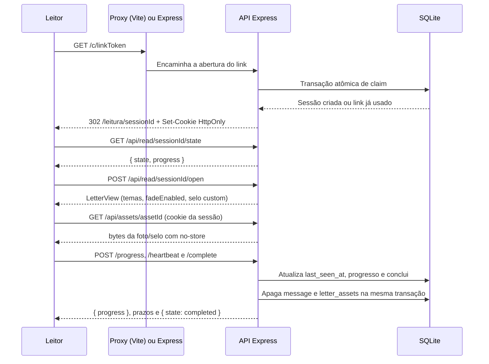

# Arquitetura

Este documento descreve a estrutura em camadas do Entrelinhas, o fluxo de uma requisição, a fronteira de confiança entre cliente e servidor e as decisões de performance da leitura. O comportamento aqui é o contrato alvo; detalhes de módulos ainda em implementação podem evoluir.

## Visão geral em camadas

| Camada | Responsabilidade | Localização |
| --- | --- | --- |
| Apresentação | Formulário de criação, prévia e experiência de leitura; roteamento por `pathname` | `frontend/src/features`, `frontend/src/App.tsx` |
| Cliente HTTP | Chamadas tipadas a `/api/*`, com `credentials: same-origin` e tratamento de `ApiError` | `frontend/src/lib/api.ts` |
| Borda HTTP | Express 5, Helmet, JSON limitado a 512 kb, upload binário separado, limitação de taxa e redirecionamento do link curto | `backend/src/app.ts` |
| Domínio | Regras de criação, emissão de tokens, upload/vínculo de assets, claim de sessão, progresso, heartbeat, prazos e conclusão | `backend/src/modules` |
| Persistência | SQLite via `node:sqlite`, migrações 001/002 (`user_version = 2`) e transações atômicas | `backend/src/db` |

O frontend nunca acessa o banco. O backend é a única autoridade sobre estado de carta, estado de sessão e progresso.

## Fluxo request/response

Antes da criação, fotos e selo desenhado seguem por `POST /api/assets` com `x-asset-kind` e voltam como `{ id, uploadToken }`; essas referências são enviadas em `POST /api/letters` e o token de upload é descartado. O autor pode escolher `fadeEnabled` e `readTimeLimitSeconds` por carta; `/state` devolve `readDeadlineAt`, `idleDeadlineAt`, `fadeEnabled` e `sealAssetId`.

Em desenvolvimento, o Vite (`5173`) encaminha `/api`, `/c` e `/leitura` para a API (`3001`). Em produção, o próprio Express pode servir o build do frontend. Os contratos completos — incluindo códigos de status — estão em [`api.md`](api.md).

## Fronteira de confiança

- **O cliente nunca é autoridade de progresso.** O navegador envia amostras de rolagem; o servidor valida a sequência, persiste `last_progress` e decide quando a leitura foi concluída. Um progresso forjado não libera estados nem apaga a carta antecipadamente.
- **O link não é credencial permanente.** A abertura consome o link (uso único) e estabelece uma sessão com cookie `HttpOnly`. A segunda abertura recebe `409`/`410`.
- **Sessão ativa por `epoch`.** Uma nova sessão incrementa o `epoch` e invalida a anterior; apenas a sessão ativa tem permissão para enviar progresso e conclusão.
- **Heartbeat e carência.** `HEARTBEAT_TTL_SECONDS` define a validade da presença da sessão; `SESSION_GRACE_MINUTES` limita a retomada única após interrupção. Depois da janela, a sessão expira. Ver [`decisions/0002-sessao-interrompida.md`](decisions/0002-sessao-interrompida.md).
- **Conclusão idempotente.** `POST /complete` aceita `Idempotency-Key`; repetições não produzem efeitos adicionais.
- **Conteúdo confiável, mas não confiável como HTML.** A mensagem da carta é texto puro: deve ser renderizada como texto, nunca injetada como markup. A formatação usa marcadores internos com whitelist, convertidos em elementos React; marcadores inválidos ou malformados permanecem como texto comum.
- **Assets: token de upload ≠ credencial de leitura.** `uploadToken` só vincula o arquivo à carta; o download exige cookie da sessão ativa. MIME, *magic bytes*, dimensões e tamanho são validados no servidor.
- **Dois prazos, uma autoridade.** `readDeadlineAt` é absoluto por carta e não muda com heartbeat; `idleDeadlineAt` deriva de `last_seen_at`. A expiração de qualquer um apaga texto e mídia atomicamente e faz as rotas de leitura responderem `410`.
- **Apagamento visual é opção do remetente.** `fadeEnabled: false` mantém as palavras visíveis até a conclusão, mas o descarte no servidor permanece obrigatório; com `true`, o efeito espera a primeira interação do leitor.

## Apagamento progressivo moderado

A calibração original da linha (70%) e do dwell (400–4000 ms, 30 ms por palavra) foi revisada por experiência do usuário: uma carta curta podia perder nitidez cedo demais e a leitura parecia apressada. A curva vigente usa a linha em **82% da viewport** (altura do contêiner de rolagem), faixa de transição de **22%** e permanência de **1000 a 6000 ms**, calculada como `min(6000, max(1000, palavras × 60))`. A transição CSS dos blocos é `opacity`/`filter` em **500 ms `ease-out`**. `fadeEnabled`, o prazo por carta e o gate de primeira interação continuam inalterados — nenhuma palavra some antes de scroll, roda, toque ou tecla de navegação. O histórico e a motivação estão em [`decisions/0003-apagamento-progressivo.md`](decisions/0003-apagamento-progressivo.md).

## Caderno local no navegador

Rascunhos e contador de cartas escritas são estado **do navegador**, não do servidor: `entrelinhas:drafts:v1` e `entrelinhas:letters-written:v1` em `localStorage`. O backend continua sendo a única autoridade sobre cartas, sessões e progresso; o caderno local nunca é consultado para liberar leitura. O contador é incrementado apenas depois de `POST /api/letters` bem-sucedido. Fotos e selo desenhado não entram no rascunho — as referências de assets não são reaproveitadas. Não há sincronização entre dispositivos, limpeza automática pelo servidor ou recuperação após limpar dados do site. Ver [`decisions/0005-caderno-local-de-rascunhos.md`](decisions/0005-caderno-local-de-rascunhos.md).

## Formatação e limites

A mensagem é validada no backend com limite de **6.000 palavras** e teto de segurança de **100.000 caracteres**. O texto rico é armazenado como texto puro com marcadores internos; um parser com whitelist converte apenas os marcadores reconhecidos em elementos React:

- `**negrito**` — negrito;
- `*itálico*` — itálico;
- `__sublinhado__` — sublinhado;
- `==destaque==` — destaque;
- `[[cor:#RRGGBB]]...[[/cor]]` — cor do trecho;
- `[[fonte:serif|hand|mono]]...[[/fonte]]` — fonte do trecho;
- `[[tamanho:sm|md|lg]]...[[/tamanho]]` — tamanho do trecho.

Marcadores inválidos ou malformados são exibidos como texto comum. HTML enviado pelo usuário não é interpretado e não há uso de `dangerouslySetInnerHTML`.

## Decisões de performance

- **`requestAnimationFrame` (rAF):** a amostragem de posição de rolagem é feita por frame, evitando cálculos a cada evento de `scroll`.
- **`IntersectionObserver` como gate:** observa quais blocos estão visíveis para limitar o trabalho de renderização; não é a fonte autoritativa de progresso.
- **Dwell com teto (curva original, revista adiante):** um bloco só era apagado após permanecer na linha por `min(4000 ms, max(400 ms, palavras × 30 ms))`.
- **Linha de leitura a 70% da viewport (valor original, revisto adiante):** referência visual estável para considerar um trecho "lido", em vez de usar o topo da tela. A calibração atual está em **82%**, detalhada na seção "Apagamento progressivo moderado".
- **`100dvh`:** altura dinâmica da viewport em dispositivos móveis, reduzindo saltos causados por barras de navegador.
- **CSS scroll-driven:** usado apenas para realce visual sob `@supports`, com fallback em JavaScript; animações são desligadas com `prefers-reduced-motion`.

O selo `custom` é desenhado em canvas apenas no painel do autor; o resultado vira PNG validado e enviado como asset. O texto continua no DOM para preservar seleção e leitores de tela. A fundamentação completa está em [`decisions/0003-apagamento-progressivo.md`](decisions/0003-apagamento-progressivo.md) e [`decisions/0004-limite-e-opcoes-de-leitura.md`](decisions/0004-limite-e-opcoes-de-leitura.md).

## Índice de decisões (ADRs)

| ADR | Assunto |
| --- | --- |
| [0001 — Token e hash](decisions/0001-token-e-hash.md) | Geração de token de 256 bits, HMAC-SHA256, dois tokens e cookie versus URL |
| [0002 — Sessão interrompida](decisions/0002-sessao-interrompida.md) | Política híbrida de retomada com janela de carência de 10 minutos |
| [0003 — Apagamento progressivo](decisions/0003-apagamento-progressivo.md) | rAF, linha de leitura, dwell, IntersectionObserver e compatibilidade com iOS Safari |
| [0004 — Limite e opções de leitura](decisions/0004-limite-e-opcoes-de-leitura.md) | Prazo por carta, apagamento visual opcional, inatividade por `last_seen_at` e assets no SQLite |
| [0005 — Caderno local de rascunhos](decisions/0005-caderno-local-de-rascunhos.md) | `localStorage` por navegador, contador local e exclusão de fotos/selo do rascunho |
