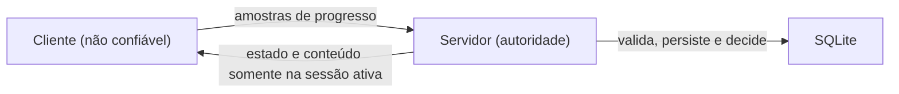

# Modelo de ameaças

Escopo: confidencialidade da mensagem, unicidade da leitura e integridade do progresso. A aplicação roda sem contas de usuário; a posse do link e a sessão emitida são os únicos mecanismos de acesso. Este documento descreve o comportamento contratual de mitigação, não detalhes de módulos em implementação.

## Ameaças e mitigação

| Ameaça | Vetor | Mitigação | Observação |
| --- | --- | --- | --- |
| **Link vazado** | URL copiada, mensagem encaminhada, histórico do navegador | Link de uso único, validade de `LETTER_TTL_DAYS=30`, cookie de sessão `HttpOnly` e `Referrer-Policy` restritiva | O link é credencial de abertura, não de leitura contínua. Não registrar o token cru em logs; rastrear por `id`. |
| **Segundo leitor** | Outra pessoa abre o mesmo link | Segunda abertura responde `409`/`410`; sessão anterior é invalidada por `epoch` quando uma nova é emitida | A janela de carência de 10 minutos permite retomada única; ver ADR 0002. |
| **Corrida de claim** | Duas aberturas simultâneas do link | Claim feito em transação atômica (`BEGIN IMMEDIATE`) com `token_hash` único e `current_session_id` | Apenas uma sessão se torna ativa para a carta. |
| **Progresso forjado** | Cliente envia `progress` alto ou repete conclusão | Servidor é a autoridade: valida a sequência, persiste `last_progress`, exige sessão ativa, heartbeat (`HEARTBEAT_TTL_SECONDS=120`) e `Idempotency-Key` em `/complete` | Scroll é apenas amostra; não prova leitura. |
| **XSS** | Conteúdo da carta interpretado como HTML | Mensagem armazenada como texto puro com marcadores internos; parser com whitelist converte apenas marcadores reconhecidos em elementos React e não interpreta HTML do usuário; React escapa por padrão; Helmet; CSP restritiva já configurada no Helmet | CSP é defesa em profundidade, não substitui escape correto; marcadores inválidos ou malformados permanecem como texto comum. |
| **Abuso de requisições** | Força bruta de links/endpoints | `RATE_LIMIT_MAX=30` por `RATE_LIMIT_WINDOW_MS=60000`, corpo JSON limitado a 512 kb, validação Zod | A aleatoriedade de 256 bits torna a adivinhação de token inviável. |
| **Token em `Referer` ou log** | Link com token gera requisição para terceiros ou é registrado | `Referrer-Policy` restritiva, redireção `302` para caminho sem token (`/leitura/:sessionId`), logs sem token cru, evitar query string | A URL `/leitura/:sessionId` não contém o token do link. |
| **bfcache / histórico** | Voltar ao estado anterior do navegador com sessão já consumida | Revalidação do estado da sessão ao retornar à página (`pageshow`/visibilidade) e expiração por heartbeat | A mitigação depende também do navegador; falhas de revalidação devem encerrar a leitura. |
| **CSRF** | Site terceiro dispara POST autenticado | Cookie com `SameSite` restritivo, endpoints JSON e validação de sessão ativa | Não há ações de efeito lateral fora do fluxo de leitura. |
| **Upload reutilizado** | `uploadToken` vazado e usado para buscar a imagem depois | Token é descartável: só vincula o arquivo em `POST /api/letters`; o hash é gravado e o par é invalidado no vínculo | Quem tem o token não consegue `GET /api/assets/:id`. |
| **Imagem buscada sem sessão** | URL de asset descoberta em log/histórico | `GET /api/assets/:id` exige cookie de sessão válido para aquela leitura; sem cookie, cookie inválido/de outra sessão ou ID inexistente retornam `404`, sem distinguir "não existe" de "sem acesso" | Respostas têm `Cache-Control: no-store, private`. |
| **Arquivo disfarçado** | `Content-Type` falso, polyglot, SVG com script, dimensões absurdas | Whitelist de MIME (`image/png`, `image/jpeg`, `image/webp`), checagem dos *magic bytes*, limites de dimensão e rejeição de tipos fora da lista; CSP `img-src` restrito | Não há reencode: ver limitações. |
| **Abuso de upload** | Arquivo gigante ou centenas de fotos | Teto por arquivo (foto 2 MiB, selo 16 KiB), máximo de 3 fotos por carta, limitação de taxa e validação no servidor (cliente é só UX) | Corpo JSON continua limitado a 512 kb; uploads são binários separados. |
| **Mídia sobrevive ao texto** | Foto ou selo continua acessível após a leitura | `letter_assets` vive no SQLite e é apagado na **mesma transação** que descarta `message`, tanto na conclusão quanto no prazo/inatividade | `ON DELETE CASCADE` cobre remoção da carta; não há armazenamento externo órfão. |
| **Leitura interminável** | Leitor mantém heartbeat ativo indefinidamente | Prazo absoluto por carta (`readTimeLimitSeconds`, padrão 600 s) não é renovado por `/heartbeat`; inatividade de 600 s (`last_seen_at`) também encerra | `/open`, `/progress`, `/complete` retornam `410` após qualquer um dos prazos. |
| **Screenshot, gravação, impressão, DevTools** | Captura da tela ou leitura do DOM/Rede | **Não mitigável pela aplicação web** | Limitação explícita: o apagamento progressivo é experiência visual, não garantia criptográfica. Evite compartilhar cartas sensíveis. |

## Limitações explícitas

- **Screenshot, gravação de tela, impressão e DevTools não são bloqueáveis.** Uma aplicação web não impede capturas fora do navegador nem leitura do DOM/Rede. O apagamento progressivo é experiência visual, **não garantia criptográfica**; não compartilhe cartas sensíveis.
- **Validação de dimensões sem reencode.** O servidor confere cabeçalhos, *magic bytes* e dimensões, mas não recodifica a imagem. Isso reduz o risco de arquivos disfarçados sem introduzir perdas ou custo de processamento; permanece uma superfície residual para imagens polimórficas que passem nas verificações.
- **`data:` na CSP.** `img-src` precisa aceitar `data:` (e, quando usado, `blob:`) para a prévia local e o selo desenhado. Isso amplia a superfície de exfiltração por imagem em comparação com uma política restrita a `'self'`; o escape do React e a whitelist de marcadores continuam sendo a defesa primária contra XSS.
- **Scroll é proxy de leitura.** O progresso inferido da rolagem não prova atenção, e o modo `fadeEnabled: false` mantém as palavras visíveis até a conclusão por opção de quem enviou.
- **Reconstrução fora da aplicação.** Depois que o texto e os assets são apagados no servidor, cópias já feitas pelo dispositivo do leitor não podem ser revogadas.

## Fronteira de confiança resumida

O cliente pode enviar valores arbitrários de progresso; nenhum deles altera o estado da carta sem validação do servidor. O conteúdo em claro é descartado após a conclusão, mas isso **não desfaz** capturas feitas fora da aplicação.
