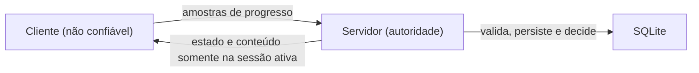

# Modelo de ameaças

Escopo: confidencialidade da mensagem, unicidade da leitura e integridade do progresso. A aplicação roda sem contas de usuário; a posse do link e a sessão emitida são os únicos mecanismos de acesso. Este documento descreve o comportamento contratual de mitigação, não detalhes de módulos em implementação.

## Ameaças e mitigação

| Ameaça | Vetor | Mitigação | Observação |
| --- | --- | --- | --- |
| **Link vazado** | URL copiada, mensagem encaminhada, histórico do navegador | Link de uso único, validade de `LETTER_TTL_DAYS=30`, cookie de sessão `HttpOnly` e `Referrer-Policy` restritiva | O link é credencial de abertura, não de leitura contínua. Não registrar o token cru em logs; rastrear por `id`. |
| **Segundo leitor** | Outra pessoa abre o mesmo link | Segunda abertura responde `409`/`410`; sessão anterior é invalidada por `epoch` quando uma nova é emitida | A janela de carência de 10 minutos permite retomada única; ver ADR 0002. |
| **Corrida de claim** | Duas aberturas simultâneas do link | Claim feito em transação atômica (`BEGIN IMMEDIATE`) com `token_hash` único e `current_session_id` | Apenas uma sessão se torna ativa para a carta. |
| **Progresso forjado** | Cliente envia `progress` alto ou repete conclusão | Servidor é a autoridade: valida a sequência, persiste `last_progress`, exige sessão ativa, heartbeat (`HEARTBEAT_TTL_SECONDS=120`) e `Idempotency-Key` em `/complete` | Scroll é apenas amostra; não prova leitura. |
| **XSS** | Conteúdo da carta interpretado como HTML | Mensagem renderizada como texto; React escapa por padrão; Helmet; CSP restritiva já configurada no Helmet | CSP é defesa em profundidade, não substitui escape correto. |
| **Abuso de requisições** | Força bruta de links/endpoints | `RATE_LIMIT_MAX=30` por `RATE_LIMIT_WINDOW_MS=60000`, corpo JSON limitado a 32 kb, validação Zod | A aleatoriedade de 256 bits torna a adivinhação de token inviável. |
| **Token em `Referer` ou log** | Link com token gera requisição para terceiros ou é registrado | `Referrer-Policy` restritiva, redireção `302` para caminho sem token (`/leitura/:sessionId`), logs sem token cru, evitar query string | A URL `/leitura/:sessionId` não contém o token do link. |
| **bfcache / histórico** | Voltar ao estado anterior do navegador com sessão já consumida | Revalidação do estado da sessão ao retornar à página (`pageshow`/visibilidade) e expiração por heartbeat | A mitigação depende também do navegador; falhas de revalidação devem encerrar a leitura. |
| **CSRF** | Site terceiro dispara POST autenticado | Cookie com `SameSite` restritivo, endpoints JSON e validação de sessão ativa | Não há ações de efeito lateral fora do fluxo de leitura. |
| **Screenshot, gravação, impressão, DevTools** | Captura da tela ou leitura do DOM/Rede | **Não mitigável pela aplicação web** | Limitação explícita: o apagamento progressivo é experiência visual, não garantia criptográfica. Evite compartilhar cartas sensíveis. |

## Fronteira de confiança resumida

O cliente pode enviar valores arbitrários de progresso; nenhum deles altera o estado da carta sem validação do servidor. O conteúdo em claro é descartado após a conclusão, mas isso **não desfaz** capturas feitas fora da aplicação.
